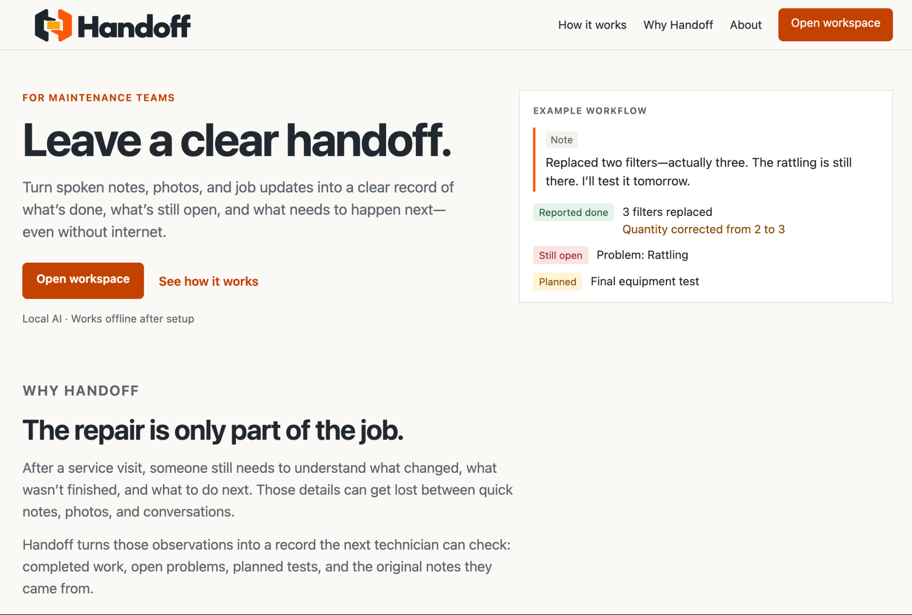

<div align="center">


# Handoff

**Clear maintenance handoffs. Powered by on-device AI.**

Turn spoken job notes into evidence-linked records of completed work, open problems, and next steps—even without an internet connection.

[Watch demo](https://www.youtube.com/watch?v=r0bODlr8o7g) · [Project overview](https://sreenidhbonagiri.github.io/handoff/) · [Run locally](#run-locally) · [Architecture](#architecture) · [Tests and evaluation](#tests-and-evaluation)

</div>

[](https://www.youtube.com/watch?v=r0bODlr8o7g)

*Handoff’s landing page. Click the image to watch the demo.*

Handoff is a local application built for maintenance technicians documenting a service visit. It combines voice and typed notes, photo attachments, a floor-plan map, and a review workflow to help the next technician understand where the job stands.

**The public website is a static overview.** The working application, database, speech recognition, and language model run on your computer after installation.

Built for c0mpiled-15 at Penn State.

## Why Handoff?

Finishing a repair is only part of finishing a job. Someone still needs to record which parts changed, what was tested, what remains unresolved, and what the next person should check.

Handoff captures those details while the work is happening. Local speech recognition and language inference let technicians process notes without relying on a connection, while keeping the original observations available for review.

## A note becomes a checkable record

> “Unit HUB-017. Replaced two filters—actually three. The rattling is still there. I’ll run the final test later.”

| Observation | Recorded meaning |
| --- | --- |
| Unit HUB-017 | Equipment identifier |
| Two filters—actually three | Three filters replaced; the earlier quantity remains in correction history |
| Rattling is still there | Unresolved problem |
| Final test later | Planned test, not completed work |

If a later note says **“The final functional test passed,”** the test updates while the rattling remains open. Facts link back to their supporting notes, and ambiguous statements can be held for review rather than accepted automatically.

This is an illustrative scenario, not a record of an actual fault at Penn State. Model output still requires technician review.

## Features

- **Voice and typed observations:** transcribe audio locally, review and edit the transcript, then submit it for extraction.
- **Evidence-linked job state:** retain sources, correction history, conflicting statements, and explicit review decisions in SQLite.
- **Checklist follow-ups:** distinguish missing information, planned work, explicitly unfinished work, and reported completion.
- **Photo attachments:** save local JPEG/PNG evidence with optional technician captions. Captions can be processed as text; photos are not interpreted by a vision model.
- **Jobs dashboard:** search saved jobs by title, equipment ID, or location and browse a paginated list.
- **Offline site map:** upload one floor plan and manually place job pins. Status reflects open issues and checklist/review state; a neutral pin is not a safety certification.
- **Ask Handoff:** a local, read-only assistant for job questions and general explanations, with evidence links for job-grounded answers. Chat does not update job facts or enter the exported report.
- **Closeout review:** inspect unfinished checks, open issues, and pending confirmations before preparing a completed-work report or a handoff with open work.
- **Local exports:** HTML and JSON reports, plus browser **Print / Save as PDF**. HTML reports embed attached photos. Reports are not automatically sent to anyone.

## Architecture

The language model proposes structured interpretations. Application code validates fields, source references, and state transitions before updating the saved record. Quote matching helps establish provenance; it does not, by itself, prove that a claim is correct.

| Layer | Technology | Responsibility |
| --- | --- | --- |
| Interface | React, TypeScript, Vite | Jobs, observations, review, chat, map, and report preview |
| Local API | FastAPI, Pydantic | Request validation and workflow orchestration |
| Storage | SQLite and local media files | Jobs, sources, facts, history, photos, audio, and map pins |
| Language inference | Ollama, `qwen3:4b` | Structured extraction and assistant responses |
| Speech recognition | whisper.cpp, `ggml-base.en.bin` | Local English transcription |
| Audio conversion | ffmpeg | Convert browser recordings for transcription |

The extraction path uses structured JSON output and `think: false`. Checklist evaluation and report generation use saved state rather than asking the model to invent a final report.

### Record integrity

- Missing evidence means **not recorded**, not “not performed.”
- Planned work does not establish completion.
- Explicit corrections retain supported earlier values and their history.
- Contradictory or ambiguous statements require review.
- A passed test does not automatically resolve a separate reported issue.
- Preparing a report does not change fact statuses.
- A report documents what was reported; it does not certify equipment safety.

## Run locally

The development and demo environment was an **M3 MacBook Pro with 16 GB unified memory**. The commands below target macOS with Homebrew installed. Python 3.12 was used during development; use a recent Node.js 22 release (22.12 or newer) for the Vite 7 frontend.

Initial installation and model downloads require internet access. Once dependencies and models are installed, the core application runs locally.

### 1. Clone and install application dependencies

```bash
git clone https://github.com/sreenidhbonagiri/handoff.git
cd handoff
python3 --version
node --version
npm --version
python3 -m venv .venv
.venv/bin/python -m pip install -r backend/requirements.txt
npm --prefix frontend ci
```

### 2. Set up the local language model

```bash
brew install ollama
```

Check whether Ollama is already running:

```bash
curl http://127.0.0.1:11434/api/tags
```

If it is not running, start it in a separate terminal and leave that terminal open:

```bash
ollama serve
```

Then, from the repository root:

```bash
ollama pull qwen3:4b
.venv/bin/python scripts/smoke_ollama.py
```

Do not start a second server if the Ollama app or service is already serving port 11434.

### 3. Optional: enable voice input

Typed observations work without the voice dependencies.

```bash
brew install ffmpeg whisper-cpp
mkdir -p models
curl -fL -o models/ggml-base.en.bin https://huggingface.co/ggerganov/whisper.cpp/resolve/main/ggml-base.en.bin
```

Allow microphone access in your browser when prompted. Review transcripts before submitting, especially equipment IDs and quantities.

### 4. Build and run

From the repository root:

```bash
npm --prefix frontend run build
.venv/bin/python -m uvicorn app.main:app --app-dir backend --host 127.0.0.1 --port 8000
```

Open **http://127.0.0.1:8000**. Keep this terminal and the Ollama service running.

For frontend development, keep the backend running and open another terminal at the repository root:

```bash
npm --prefix frontend run dev
```

Open the development URL printed by Vite, normally **http://127.0.0.1:5173**.

### First job

1. Open the workspace and create a job.
2. Add a typed observation or record and review a voice note.
3. Inspect the extracted facts and supporting notes.
4. Answer follow-up questions or review ambiguous statements.
5. Optionally attach photos and place the job on an uploaded floor plan.
6. Open **Review before leaving**, preview a report, and export it.

To check offline operation, disconnect from the internet after setup and process a new observation with the local services still running.

## Local data and configuration

Default storage locations:

| Data | Location |
| --- | --- |
| Job database | `backend/fieldpilot.db` |
| Audio | `backend/data/audio/` |
| Photos | `backend/data/photos/` |
| Floor-plan images | `backend/data/site/` |
| Speech model | `models/ggml-base.en.bin` |

Some internal paths and environment variables retain the original **FieldPilot** name for compatibility.

Useful environment variables, set before starting the backend:

| Variable | Default |
| --- | --- |
| `OLLAMA_URL` | `http://127.0.0.1:11434` |
| `FIELDPILOT_MODEL` | `qwen3:4b` |
| `FIELDPILOT_DB` | `backend/fieldpilot.db`, resolved from the project |
| `WHISPER_CLI` | `whisper-cli` |
| `WHISPER_MODEL` | `models/ggml-base.en.bin`, resolved from the project |

Keep databases, recordings, uploaded photos, floor plans, and model files out of Git. Local storage is not a claim of encryption or complete device security. This prototype is intended for local use, not as a publicly exposed multi-user service.

## Tests and evaluation

From the repository root:

```bash
.venv/bin/python -m unittest discover -s backend/tests
npm --prefix frontend run typecheck
npm --prefix frontend run build
```

The test files cover job state, evidence handling, job isolation, photo uploads, voice processing, the site map, and assistant behavior. Voice integration checks need the speech dependencies; some audio fixtures depend on macOS speech synthesis. Read test output for dependency failures or skips rather than treating them as successful integration checks.

For real local model evaluation, install and start Ollama with the configured model, then run:

```bash
.venv/bin/python scripts/smoke_ollama.py
.venv/bin/python evals/run_eval.py
```

The evaluation runner compares the application against a one-pass baseline on development cases. Development examples are not an independent measure of general accuracy. Record the model, hardware, case set, and actual results when reporting performance; test counts and inference latency vary with the revision and environment.

## Limitations

- Small local models can misclassify observations, omit details, or produce unsupported assistant text. Source links and validation support review; they do not guarantee correctness.
- Speech recognition can mishear equipment identifiers and numbers.
- Inference can take several seconds or longer, depending on input, hardware, and model loading.
- Photos are attachments, not visual diagnosis. OCR and manual-grounded repair guidance are not implemented.
- The map supports one uploaded floor plan with manually placed job pins, not GPS or automatic equipment localization.
- Assistant chat is session-only and read-only. It is not a verified repair procedure or a substitute for equipment documentation.
- PDF export uses the browser print dialog. Handoff does not provide automatic report delivery or cloud synchronization.

## Repository guide

| Path | Contents |
| --- | --- |
| `backend/app/` | API, inference, validation, persistence, transcription, maps, and reports |
| `backend/tests/` | Backend tests |
| `backend/data/checklist.json` | Sample closeout checklist |
| `frontend/src/` | React application and UI components |
| `evals/` | Development cases, baseline, and evaluation runner |
| `scripts/` | Model smoke test and status-wording checks |
| `.github/workflows/pages.yml` | Static showcase deployment |
| `FieldPilot-Build-Brief.md` | Original planning document; historical scope, not current feature status |

